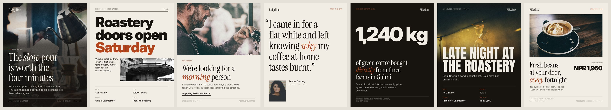
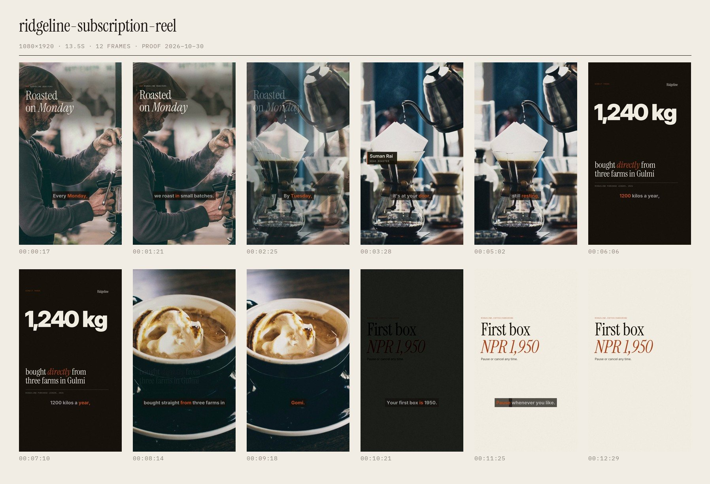
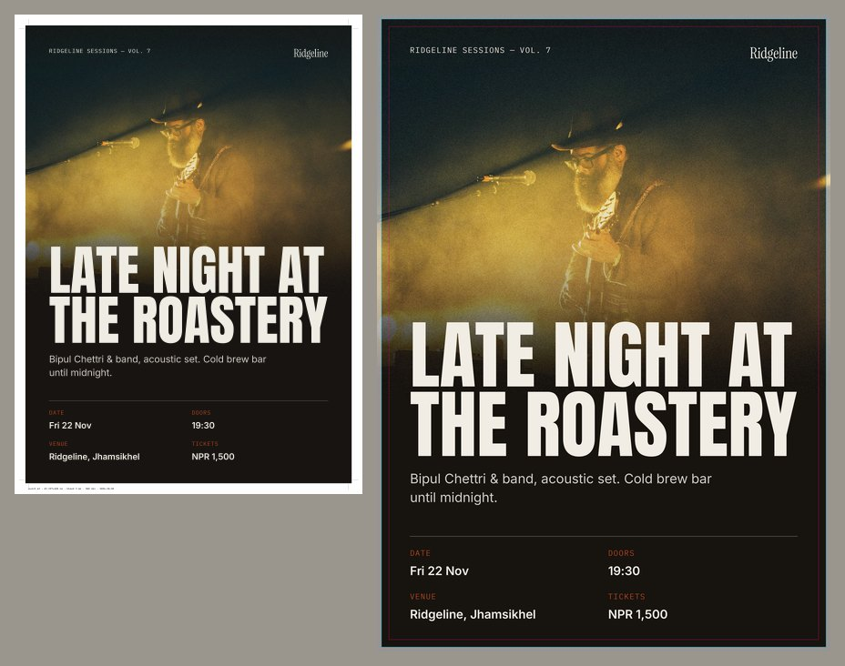
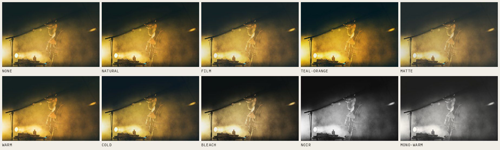

# contentkit

An open-source content studio for people who make things for brands: grid-based posters
and carousels, print-ready PDFs, branded video with captions and sound, all from short
YAML recipes. It runs offline on your own machine: no subscriptions, no watermarks, no
upload of client material.





| Print export (A3, bleed + crop marks, CMYK) | One colour system for stills and video |
|---|---|
|  |  |

## Contents

- [Who it's for](#who-its-for)
- [Install](#install)
- [Quick start](#quick-start)
- [Brand kit](#brand-kit)
- [Posters and carousels](#posters-and-carousels)
- [Print](#print)
- [Video](#video)
- [Music-driven edits](#music-driven-edits)
- [Meme, reaction and commentary edits](#meme-reaction-and-commentary-edits)
- [Critique an edit](#critique-an-edit)
- [Copy an edit from a reference](#copy-an-edit-from-a-reference)
- [Meme and funny posters](#meme-and-funny-posters)
- [Footage fixes and meme placement](#footage-fixes-and-meme-placement)
- [Plan the shoot and the hook](#plan-the-shoot-and-the-hook)
- [Open-source projects inside](#open-source-projects-inside)
- [Use it from any project (agent skill)](#use-it-from-any-project-agent-skill)
- [Audio](#audio)
- [Colour looks](#colour-looks)
- [Safe zones](#safe-zones)
- [Proof sheets](#proof-sheets)
- [Command reference](#command-reference)
- [Python API](#python-api)
- [Design rules built in](#design-rules-built-in)
- [Project layout](#project-layout)
- [Licenses and credits](#licenses-and-credits)
- [Specs and sources](#specs-and-sources)
- [Troubleshooting](#troubleshooting)
- [Changelog](#changelog)

## Who it's for

| You are | You get |
|---|---|
| **Designer** | 7 grid layouts (editorial, swiss, split, quote, stat, event, offer) that adapt to every social size and to A-series/US print. A real typesetting engine: kerning-aware tracking, balanced line breaks without widows, cap-height alignment, smart punctuation, hanging quotes, `*emphasis*` in a second face. Bundled OFL fonts. |
| **Video editor** | Photo, footage, layout and card scenes; eased camera moves around a focal point; 24 xfade transitions; animated titles and lower thirds; four caption styles kept inside platform safe zones; LUT grading; film grain; jump cuts with punch-ins; BT.709-correct H.264 masters. |
| **Producer / agency** | One recipe, every deliverable: `deliver: [reel, square, landscape]` renders each format plus an SRT, a 16:9 thumbnail, a vertical cover and a `manifest.json` (sizes, durations, measured loudness). Print PDFs with TrimBox/BleedBox. Timecoded proof sheets for client sign-off. |
| **Small business** | A `brand.yaml` with your colours, type, grade and handle; every post, poster and video comes out on-brand without opening a design app. |

## Install

Requirements: Linux, macOS or WSL, Python 3.10+, and ffmpeg built with libass (the
standard distro and Homebrew builds are).

```bash
sudo apt install ffmpeg espeak-ng            # macOS: brew install ffmpeg espeak-ng
git clone https://github.com/siddanta-ar1/contentkit.git && cd contentkit
python3 -m venv .venv
.venv/bin/pip install -e ".[all]"            # core + Piper TTS + faster-whisper
.venv/bin/python -m piper.download_voices --data-dir ~/.contentkit/voices en_US-ryan-high
.venv/bin/contentkit sfx init                # synthesize the sound-effects pack
```

| Install | You get |
|---|---|
| `pip install -e .` | Posters, print, video, SFX, espeak-ng voice, script-timed captions |
| `pip install -e ".[tts]"` | + Piper neural voices (offline) |
| `pip install -e ".[captions]"` | + faster-whisper word-accurate captions from any recording |
| `pip install -e ".[fetch]"` | + current yt-dlp for `contentkit fetch` (distro packages fall behind YouTube) |
| `pip install -e ".[all]"` | Everything |

In another project: `pip install "contentkit[all] @ git+https://github.com/siddanta-ar1/contentkit.git"`.

## Quick start

```bash
source .venv/bin/activate
contentkit poster examples/posters/editorial.yaml -o out/editorial.jpg
contentkit poster examples/posters/editorial.yaml --format reel -o out/story.jpg   # same design, 9:16
contentkit poster examples/carousel.yaml -o out/carousel                            # 5 slides
contentkit print  examples/posters/event.yaml --size a3 -o out/event-a3             # PDF + CMYK TIFF + proof
contentkit video  examples/reel.yaml -o out/reel.mp4
contentkit video  examples/video/subscription-launch.yaml -o out/launch             # 3 formats + SRT + thumbs
contentkit proof  out/launch/ridgeline-subscription-reel.mp4                        # client proof sheet
```

Every example uses the fictional brand in `examples/brand.yaml` and CC0 photography in
`examples/assets/photos`. Copy an example, then change the words and pictures.

## Brand kit

```yaml
# brand.yaml  (contentkit brand init --preset editorial --name "Your Brand")
name: Ridgeline                 # wordmark when there is no logo
handle: "@ridgeline.roasters"
url: ridgeline.coffee
logo: logo.png                  # optional, PNG with transparency
colors:
  ink: "#17130f"                # text / dark backgrounds
  paper: "#f2ede4"              # light backgrounds / text on dark
  accent: "#b4441c"             # kickers, one emphasised word, lower-third bar
  muted: "#8b8279"              # labels, metadata
type:
  display: "Instrument Serif"           # headlines
  display_em: "Instrument Serif:italic" # *emphasis* inside headlines
  heavy: "Inter Display:black"          # grotesk headlines (swiss, stat, prices)
  condensed: "Anton"                    # event posters
  text: "Inter"                         # body copy
  text_strong: "Inter:semibold"
  mono: "IBM Plex Mono"                 # labels, folios, metadata
look: film                      # colour grade for every photo and video
grain: 0.03                     # film grain on photos and video (0 = off)
captions: {style: clean}        # default caption style for videos
```

Presets: `default`, `editorial`, `swiss`, `noir`, `fresh` (`contentkit brand presets`).
Recipes point at a kit with `brand: path/to/brand.yaml` or a preset name. Fonts can be
any bundled face (below), any installed family (`"EB Garamond:bold"`) or a `.ttf/.otf` path.

Bundled (SIL Open Font License): **Inter / Inter Display** (Regular to Black),
**Instrument Serif** (Regular, Italic), **Anton**, **IBM Plex Mono** (Regular, Medium).

## Posters and carousels

```bash
contentkit layouts                                  # list layouts and required fields
contentkit poster RECIPE.yaml -o out.jpg [--format reel] [--layout stat]
```

| Layout | Needs | Use it for |
|---|---|---|
| `editorial` | title, image | Magazine cover feel: full-bleed photo, serif headline low on the page, masthead and folio |
| `swiss` | title | Announcements, open days, schedules: one heavy grotesk, flush left, asymmetric image, info grid |
| `split` | title, image | Hiring, product, service: photo half + typography half |
| `quote` | quote | Testimonials, reviews, founder lines: hung punctuation, small portrait |
| `stat` | stat | Reports, milestones, impact: one number carries the post, source line underneath |
| `event` | title, image | Gigs, launches, workshops: photo melts into ink, condensed title on the seam, date/venue grid |
| `offer` | title, image | Promotions, subscriptions, menus: framed product photo, headline, price, terms |

Fields (use what the layout needs): `title`, `kicker`, `dek`, `body`, `image`,
`focus: [x, y]` (0–1 focal point for cropping), `zoom` (punch in on the focal point),
`look` (override the brand grade), `details` (list of `"Label: value"`), `number`,
`issue`, `quote`, `author`, `role`, `variant: dark|light`, `stat`, `label`, `context`,
`source`, `subtitle`, `duotone: ["#shadow", "#highlight"]`, `price`, `was`, `terms`, `cta`,
`footer_left`, `footer_right`, `platform` (safe zone for 9:16, default `stories`).

Wrap words in `*asterisks*` to set them in the emphasis face/colour.

**Formats:** `square` 1080², `portrait` 1080×1350, `reel` 1080×1920, `landscape`
1920×1080, `thumbnail` 1280×720, `og` 1200×630. Every layout works in every format; on 9:16
the margins grow to clear platform UI.

**Carousels:** a recipe with `slides:` (each slide has its own `layout`) renders
`slide_01.jpg…`, all sharing brand and format, with an automatic `01 / 05 →` folio.
See `examples/carousel.yaml`.

## Print

```bash
contentkit print RECIPE.yaml --size a3 [--dpi 300] [--orientation landscape] [--icc fogra39] [--no-marks]
```

Writes three files:

| File | What it is |
|---|---|
| `NAME.pdf` | Lossless CMYK (Flate) with the ICC profile embedded, 3 mm bleed, crop marks and a slug line outside the bleed, and correct **TrimBox / BleedBox / MediaBox** for prepress checks |
| `NAME-cmyk.tif` | The same sheet as CMYK TIFF (LZW, 300 dpi, profile embedded), which most printers also accept |
| `NAME-proof.jpg` | RGB review copy with bleed shaded, trim in cyan, 5 mm safe area in magenta |

Sizes: `a5 a4 a3 a2 a1 letter tabloid 18x24 24x36`. Profiles: `fogra39` (ISO Coated v2,
Europe/Asia, default), `fogra47` (uncoated), `gracol` (US coated), `swop` (US web), or a
path to any `.icc`. Profiles are looked up in `/usr/share/color/icc` (installed with
colord) and `~/.contentkit/icc`, or set `CONTENTKIT_CMYK_ICC`.

Note: artwork, including type, is rasterised at the export DPI. That is right for posters
and flyers. For very small print type (below ~8 pt) or vector requirements, finish in a
DTP application. Always check your printer's own spec; some ask for 5 mm bleed or PDF/X.

## Video

```bash
contentkit video RECIPE.yaml -o out/name [--only reel,square] [--keep work/]
```

Pipeline: voiceover → scenes → join → mix → master → finish → deliver. Each step is
described at the top of `contentkit/video.py`.

### Recipe

```yaml
brand: brand.yaml
format: reel                        # single output, or:
deliver: [reel, square, landscape]  # one render per format + SRT + thumbnail + cover + manifest.json
name: spring-launch                 # file stem for deliverables
platform: universal                 # caption/title safe zone: universal | reels | tiktok | shorts | stories
look: film                          # grade (default: brand look) or path/to/your.cube
grain: 0.03                         # default: brand grain
progress: true                      # accent progress bar (top; or "bottom")
transition: {type: fade, duration: 0.4}   # default between scenes; "cut" for hard cuts
transition_sfx: whoosh              # on every cut (null = off)
transition_volume: 0.45
preset: medium                      # x264 speed; crf: 18 default
srt: true                           # single-format renders: write an .srt alongside
thumbnail:                          # any poster layout; `true` = editorial from the first image scene
  layout: editorial
  image: photos/hero.jpg
  title: Spring *menu*

voiceover:
  text: "Script to speak."          # Piper/espeak-ng, or:
  file: takes/vo.wav                # your recording
  clean: normal                     # normal | light | false   (default: normal for files, light for TTS)
  engine: auto                      # auto | piper | espeak
  voice: path/to/voice.onnx
  speed: 1.0
  delay: 0.3
  volume: 1.0

music: {file: music/bed.mp3, volume: 0.25, duck: true, fade_in: 0.6}

captions:
  style: clean                      # pop | clean | boxed | serif
  source: auto                      # auto (whisper if installed) | whisper | script
  words: 5                          # words per caption (style default otherwise)
  position: 0.72                    # vertical centre as a fraction of height (default: from safe zone)
  accent: "#b4441c"                 # spoken-word colour (default: brand accent)
  language: en
  model: small                      # whisper size

scenes:                             # scenes without duration share the voiceover length
  - image: photos/a.jpg             # PHOTO
    focus: [0.45, 0.35]
    move: in                        # in | out | left | right | up | down | none
    look: noir                      # per-scene grade override; grade: false to skip
    kicker: Label
    title: Overlay *headline*
    title_position: top             # top | center | bottom
    lower_third: {name: Suman Rai, role: Head roaster}
    sfx: [pop, {name: boom, at: 0.2, volume: 0.6}]
    transition: {type: slideleft, duration: 0.35}   # into this scene

  - video: footage/clip.mp4         # FOOTAGE
    start: 12.5
    duration: 4
    focus: [0.5, 0.4]               # crop-to-fill focal point
    keep_audio: true
    volume: 0.4

  - layout: stat                    # ANY POSTER LAYOUT as a full-frame scene
    stat: "1,240 kg"
    label: bought *directly*

  - color: "#f2ede4"                # TYPOGRAPHIC CARD
    kicker: ridgeline.coffee
    title: First box *NPR 1,950*
    body: Pause any time.
    fade: true
```

Transitions: `cut fade fadeblack fadewhite dissolve slideleft slideright slideup slidedown
wipeleft wiperight wipeup wipedown smoothleft smoothright smoothup smoothdown circleopen
circleclose zoomin hblur pixelize radial squeezeh squeezev`. `fade` is a true crossfade;
`dissolve` is ffmpeg's pixel-noise dissolve, which is rarely what you want.

Caption styles:

| Style | Look | Use for |
|---|---|---|
| `pop` | Heavy uppercase, spoken word in accent, pops in | Talking-head growth content |
| `clean` | Sentence case on a translucent plate, unspoken words dimmed | Brand, product, interviews |
| `boxed` | Solid plate | Busy footage, accessibility |
| `serif` | Instrument Serif, spoken word in accent italic | Lifestyle, food, fashion (dark footage) |

Layout and card scenes keep their type above the caption band automatically.

### What you get with `deliver`

```
out/launch/
  ridgeline-subscription-reel.mp4        1080×1920
  ridgeline-subscription-square.mp4      1080×1080
  ridgeline-subscription-landscape.mp4   1920×1080
  ridgeline-subscription.srt             2 lines × 42 chars max, ≤ 6 s per cue
  ridgeline-subscription-thumbnail.jpg   1280×720
  ridgeline-subscription-cover.jpg       1080×1920 (Reels cover)
  manifest.json                          per-file size, duration, measured LUFS / true peak
```

Masters: H.264 High, yuv420p, BT.709 primaries/transfer/matrix (tagged, and converted
correctly from RGB stills, so colours don't shift after platform re-encodes), CRF 18
capped at 16 Mb/s, AAC 256 kb/s 48 kHz, `+faststart`.

## Music-driven edits

Cut on the beat of any song, starting at its best part, with a zoom kick on every beat.

```bash
contentkit fetch --search "resham firiri remix" --audio     # top YouTube result -> mp3
contentkit fetch --list firiri                               # find it again later by title
contentkit beats ~/.contentkit/downloads/youtube_XXXX.mp3    # BPM, first beat, hook
contentkit template new birthday-remix content/aasha-bday    # recipe + media/ folder
```

```yaml
music:
  file: ~/.contentkit/downloads/youtube_XXXX.mp3
  start: hook          # the most energetic 20 s, snapped to a downbeat (or seconds: 42.5)
  sync: beat           # every cut lands on a beat ("bar" = every 4 beats)
  beats_per_cut: 2     # default length of scenes without `beats:`
  pulse: true          # zoom kick on each beat (or a strength, e.g. 0.02)
  bpm: 128             # optional: skip tempo detection
scenes:
  - {image: media/cake.jpg, beats: 4}      # hold the big moments
  - {image: media/dance.jpg, beats: 1}     # fast moments
```

How it works: spectral-flux onsets, tempo by autocorrelation, then tempo and phase
fitted together with the kick band weighted up so off-beat hi-hats don't win. On test
tracks from 90 to 140 BPM, tempo is within 0.1 BPM and downbeats within ±9 ms. Cut times
are placed on the exact beat grid and only then rounded to frames, so they never drift.
With a voiceover, scenes are sized by the voice and then snapped to whole beats; music
ducks under the voice. On synced edits the transition whoosh is off by default (the song
is the transition).

Templates (`contentkit template list`):

| Template | What it makes |
|---|---|
| `birthday-remix` | Song-only reel: title over the venue, cake and candle beats held, quick dance cuts, end card |
| `hotel-remix` | Your talking clip as the voice (lip-synced opener), b-roll cut on the beat, rating stat, end card |

**Private mode** (`contentkit private on`): for content that stays on your machine.
Downloads are labelled `private use (local only)` instead of `UNKNOWN`. Every download is
indexed in `~/.contentkit/downloads/index.json` with title, uploader, URL and duration.

## Meme, reaction and commentary edits

Any `video:` scene can take these (photos take the overlays too):

```yaml
- video: media/clip.mp4
  start: 3.2
  duration: 3
  keep_audio: true
  header: "POV: your friend actually remembered your birthday"   # white caption bar on top
  zoom_to: {at: 1.1, focus: [0.68, 0.33], scale: 2.4, hold: 1.0} # snap zoom (+ vine-boom)
  freeze: {at: 1.0, hold: 1.4}                                   # freeze frame (+ record-scratch)
  speed: 0.5                                                     # slow-mo; 2 = double; reverse: true
  meme: {top: "when the kitkat hits", bottom: "different"}       # classic meme text
  texts: [{at: 1.0, until: 2.4, text: "wait for it", style: meme, position: bottom}]
  callouts: [{at: 1.0, until: 2.4, shape: circle, rect: [0.38, 0.47, 0.2, 0.09], label: "the gift"}]
  split: {video: media/other.mp4, start: 8.6, labels: ["before", "after"]}   # stacked / side by side
  pip: {video: media/my-face.mp4, start: 0, corner: tr, size: 0.32}          # reaction cam
  source: "via @handle"                                          # credit for clipped footage
```

Two scene options built for punchlines: `mute_music: true` cuts the music dead as that
scene starts (the silence is what makes a sad-trombone or record-scratch land), and
`look: noir` (or any look / `.cube`) grades just that scene, for example a black-and-white
"it's over" ending.

`focus` and `rect` are fractions of the frame (0–1): read them off a proof sheet. Text
styles: `meme` (white Anton with black outline), `label` (annotation plate), `plain`.
Callout shapes: `circle`, `box`, `arrow`. Zoom and freeze bring their sound automatically;
`sfx: null` on the edit silences it. Edit times are seconds into the scene.

Comedy sounds in the SFX pack: `vine-boom record-scratch airhorn dramatic boing slide-up
slide-down sad-trombone cha-ching`.

Templates: `meme-edit` (POV setup → zoom on the reaction → freeze on the punchline →
slow-mo fail) and `commentary` (your voice, callouts, zoom on the proof, split compare,
reaction cam, verdict card).

**Clips from social sites.** `fetch` uses yt-dlp, so Instagram, Facebook, TikTok, X,
Reddit, YouTube and ~1,800 other sites work:

```bash
contentkit fetch "https://www.instagram.com/reel/…" --out content/job/media
contentkit fetch "https://www.facebook.com/…/videos/…" --browser chrome --out content/job/media
contentkit fetch "<url>" --section 12-20 --out content/job/media       # only the part you need
```

Instagram and Facebook usually serve videos only to logged-in users. `--browser chrome`
(or `brave`, `firefox`, `edge`) lets yt-dlp use the login already in that browser on your
machine; `--cookies cookies.txt` uses an exported cookie file instead. On Linux, Chrome
and Brave encrypt their cookies with the system keyring: install `pip install
secretstorage` (included in `.[fetch]` / `.[all]`) for `--browser` to read them. For
YouTube, `fetch` passes your Node.js to yt-dlp as the JavaScript runtime it now needs.

## Critique an edit

```bash
contentkit analyze out/meme.mp4 --kind meme      # meme | remix | commentary | brand
```

```
meme.mp4  ·  meme  ·  score 61/100
  length       13.6s   1080x1920
  shots        8   first cut 1.13s   avg 1.7s   longest 3.0s
  loudness     -11.5 LUFS   true peak -1.0 dBTP
  FIX     [loudness] -11.5 LUFS; deliver at -14 (contentkit master FILE).
  IMPROVE [dead air] Silence 4.2-5.4s. Fill it (sfx, music) or cut it, unless it's the joke.
```

It measures hook speed (time to the first cut), pacing (average and longest shot), dead
air, loudness and true peak, black frames, frozen stretches, aspect and resolution, then
scores against working rules for that kind of video. Cuts are detected on blurred 48-px
thumbnails, so on-beat zoom pulses and grain don't count as cuts; a jump between two
near-identical framings of the same action doesn't either. `--json report.json` saves the
numbers. The agent skill runs it after every render and fixes what it flags (target 80+).
The example above is the meme test before a music bed was added; after, it scores 100.

## Copy an edit from a reference

Give it a video that works and it measures the edit, then rebuilds that structure on your footage.

```bash
contentkit reference analyze "https://www.instagram.com/reel/…" -o refs/coffee-trend
contentkit reference recipe refs/coffee-trend/analysis.json --media content/job/media -o content/job/recipe.yaml
```

`analyze` writes `reference.mp4`, `audio.wav`, `analysis.json`, `ANALYSIS.md` (a shot table
and a beat sheet to fill in) and `shots.jpg` (one still per shot). For every shot it records
start, length, framing (from the largest face: wide / medium / close-up), on-screen text
and where it sits (OCR), and how much moves. For the whole video it records cut rhythm, BPM,
the share of cuts that land on the beat, loudness, the hook (first cut, text and face on the
first frame) and whether the video loops; `--transcribe` adds the speech.

`recipe` writes a recipe with the same number of shots, the same lengths (or beat counts
when the reference cuts on the beat), text at the same positions and times, filled with
your media in order. Borrowed text comes in as `<rewrite: original>`, and contentkit refuses
to render a recipe that still has `<…>` placeholders. `--use-audio` keeps the reference's
sound track: fine for private edits, but platforms demote reused audio and footage
(Meta's originality rules, 2025), so for posting use your own or in-app audio.

## Meme and funny posters

| Layout | Fields | Use |
|---|---|---|
| `meme` | `image`, `top`, `bottom` | classic image macro (white Anton, black outline) |
| `versus` | `images: [a, b]`, `labels`, `title` | expectation vs reality, before/after, nope/yep |
| `post` | `text`, `name`, `handle`, `avatar`, `image`, `meta` | a text post card under *your own* name, no platform logos |
| `comic` | `panels: [{image, caption, speech}]`, `title` | 2–4 panel strip with caption boxes and speech bubbles |

Examples in `examples/memes/`. They work in every format, carousels included.

## Footage fixes and meme placement

```yaml
- video: media/handheld.mp4
  stabilize: true            # two-pass vidstab (deshake if ffmpeg lacks it); "strong" smooths more
  denoise: light             # light | medium | strong (nlmeans), for low-light shots
  reframe: auto              # horizontal clip in a vertical reel: crop follows the face (OpenCV)
  overlay:                   # green-screen meme clip keyed over your footage
    - {video: memes/explosion-gs.mp4, at: 1.2, until: 2.6, key: green, position: center, scale: 0.8}
  stickers:                  # image on top; cutout: true removes its background (rembg)
    - {image: memes/thumbs-up.png, at: 0.5, until: 2.0, position: br, scale: 0.3}
```

`key` takes `green`, `blue`, `black`, `white`, a hex colour, or `none` (no keying). Positions:
`center top bottom left right tl tr bl br full`, kept inside the platform safe zone.

## Plan the shoot and the hook

```bash
contentkit shotlist hotel          # birthday food product real-estate wedding event talking-head
contentkit hooks                   # hook formulas: pov curiosity contrarian story list challenge reaction local
contentkit hooks collect URL URL --seconds 3   # save just the openings of videos you want to study
```

Shot lists give the shot, framing/move, how long to roll and why, plus a shoot checklist
(vertical 4K, locked exposure, 45° window light, handles, room tone, one look-to-lens shot).
`hooks collect` keeps the first seconds of each video with its hook-frame text and framing
in `~/.contentkit/hooks/index.json`.

`contentkit analyze` also checks viral readiness: readable text on the hook frame, a face
on it, motion in the first second, whether the video loops, and soft or badly exposed
shots. These are proxies for what platforms reward (watch-vs-skip, completion, replays),
not a prediction: no tool can promise a video goes viral.

**Growing an audience** (summarised in the agent skill): platforms rank on watch time,
completion, replays and shares; accounts that repost others' videos or audio lose reach
on everything; "tag a friend / comment YES" captions are demoted; under 30 s with the
payoff before the end, and a loop to frame 1, earns replays.

## Open-source projects inside

| Project | License | What contentkit uses it for |
|---|---|---|
| [FFmpeg](https://ffmpeg.org) (+ libass, vidstab, chromakey, loudness filters) | LGPL/GPL | every render, captions, stabilisation, keying, audio |
| [yt-dlp](https://github.com/yt-dlp/yt-dlp) | Unlicense | downloads from YouTube, Instagram, Facebook, TikTok, X, Reddit … |
| [OpenCV](https://opencv.org) + [YuNet](https://github.com/opencv/opencv_zoo) face model | Apache-2.0 / MIT | face framing, auto-reframe, hook-frame checks |
| [Tesseract](https://github.com/tesseract-ocr/tesseract) | Apache-2.0 | reading on-screen text in references (English; Nepali opt-in) |
| [faster-whisper](https://github.com/SYSTRAN/faster-whisper) | MIT | word-timed captions, transcripts |
| [Piper](https://github.com/OHF-Voice/piper1-gpl) | GPL-3.0 | offline voiceover |
| [rembg](https://github.com/danielgatis/rembg) (optional) | MIT | sticker background removal |
| Pillow, NumPy, PyYAML | MIT-CMU / BSD / MIT | layout, imaging, recipes |

Considered and left out for now: **auto-editor** and **PySceneDetect** (contentkit's own
silence cutting and pulse-aware cut detection cover their use here), **Demucs** (vocal
removal, needs PyTorch and ~2 GB) and **Real-ESRGAN** (upscaling, needs a GPU to be
practical). Both are worth adding on a machine with the disk and GPU for them.

## Use it from any project (agent skill)

```bash
contentkit skill install global              # every project: ~/.claude/skills/contentkit
contentkit skill install ~/work/hotel-site   # one project: <project>/.claude/skills/contentkit
```

Then, in that project, just ask Claude Code: *"make a birthday reel for Aasha with a
Resham Firiri remix, photos are in ~/Pictures/bday"* or *"hotel review reel for Yak & Yeti
from these clips"*. The skill tells the agent to: find contentkit, download and analyse
the song, start from a template, fill the recipe with your files and words, render a
preview, **look at the proof sheet**, fix what's wrong, then render every format. Jobs live
in `content/<job>/` inside the project. `contentkit skill show` prints the skill.

## Audio

```bash
contentkit clean take.wav [--strength light] [--master]   # voice chain
contentkit cut talk.mp4 --punch 1.1                        # remove pauses, punch-in on alternate cuts
contentkit master mix.wav [--lufs -14] [--tp -1]           # two-pass loudness master
contentkit tts "Text" -o vo.wav
contentkit sfx init | list | play whoosh | add laugh.wav --source URL --license CC0
```

- **Voice chain**: high-pass 80 Hz → spectral denoise → −2 dB @ 250 Hz (mud) → +2.5 dB @
  3.5 kHz (presence) → de-esser → 3:1 compression → limiter.
- **Jump cuts**: silence detection with padding so words aren't clipped, 12 ms fades at every
  edit (no clicks), optional punch-in on alternate segments to hide the jump. Writes
  `NAME.cuts.json` with every kept range.
- **Mastering**: measure (EBU R128), apply the exact gain, limit to the true-peak ceiling,
  re-measure and correct if the limiter moved the level. Lands within ±0.1 LU of −14 LUFS
  and under −1 dBTP, including edits with silences next to loud hits, where ffmpeg's
  two-pass loudnorm quietly falls back to its dynamic mode and misses.
- **Sound effects**: 24 synthesized effects (whoosh, swoosh-up, pop, click, tick, ding,
  notify, sparkle, boom, bass-drop, riser, glitch, buzzer, shutter, heartbeat, plus the
  comedy set: vine-boom, record-scratch, airhorn, dramatic, boing, slide-up, slide-down,
  sad-trombone, cha-ching), generated
  locally, so they carry no third-party license. Your own sounds are tracked with their
  source and license in `~/.contentkit/sfx/library.json`.

## Colour looks

`none natural film teal-orange matte warm cold bleach noir mono-warm`, or any `.cube` LUT.

```bash
contentkit looks --preview photo.jpg -o looks.jpg     # every look side by side
contentkit looks --export film -o film.cube           # use the same grade in Resolve/Premiere
```

A look is one function: posters apply it to pixels; videos get it baked into a 33³ `.cube`
for ffmpeg's `lut3d`. Stills and footage therefore match: the baked LUT reproduces the
direct grade within 0.2% mean error. Looks are deliberately gentle; a grade should be
felt, not noticed.

## Safe zones

```bash
contentkit safezone story.jpg                       # all platforms, colour-coded with a legend
contentkit safezone reel.mp4 --platform tiktok --at 3.5
```

Pixel insets at 1080×1920 (scaled for other sizes):

| Platform | Top | Bottom | Left | Right |
|---|---|---|---|---|
| universal | 220 | 420 | 60 | 140 |
| reels | 220 | 400 | 60 | 130 |
| tiktok | 160 | 480 | 60 | 150 |
| shorts | 180 | 420 | 60 | 130 |
| stories | 250 | 340 | 60 | 60 |

These are industry measurements of the app UIs, not published platform specs, and the
apps change. Check a test upload on a phone before a campaign ships.

## Proof sheets

```bash
contentkit proof out/launch/ridgeline-subscription-reel.mp4 --frames 12   # timecoded contact sheet
contentkit proof out/carousel --cols 5 --title "Brew guide"               # board of stills
```

## Command reference

| Command | Purpose |
|---|---|
| `poster` | Render a layout recipe (or carousel) to JPG/PNG; `--format`, `--layout` overrides |
| `post` | Same as `poster` for layout recipes; also runs the classic v0.1 single-card recipes |
| `print` | Print PDF + CMYK TIFF + proof with bleed, crop marks, page boxes |
| `video` | Render a video or all `deliver:` formats; `--only`, `--keep` |
| `cut` | Silence-removal jump cuts with optional punch-in |
| `clean` | Voice cleanup chain; `--master` |
| `master` | Two-pass loudness master |
| `captions` | Burn styled captions onto any video; `--style`, `--srt` |
| `proof` | Contact sheet for a video or a board of images |
| `safezone` | Platform UI overlay on an image or video frame |
| `looks` | List, preview, or export looks as `.cube` |
| `layouts` | List layouts (11: 7 design + 4 meme/funny) |
| `brand` | `init` a brand kit from a preset; `presets` |
| `sfx` | Sound library: `init list play add` |
| `tts` | Text to speech |
| `fetch` | Download by URL (YouTube, Instagram, Facebook, TikTok, X …) or `--search "song"`; `--browser` login; `--list` the library |
| `analyze` | Critique an edit: hook, pacing, dead air, loudness, defects, viral readiness, footage QC |
| `reference` | `analyze URL|file`, `recipe analysis.json --media DIR`: copy an edit's structure |
| `shotlist` | Shot list + shoot checklist for a job type |
| `hooks` | Hook formulas; `hooks collect URL …` saves video openings |
| `config` | Show or set settings (`ocr_langs eng+nep`) |
| `beats` | Song tempo, first beat and hook |
| `template` | `list`, `new NAME DIR`: start a job (birthday-remix, hotel-remix, meme-edit, commentary) |
| `skill` | `install [global|PROJECT]`, `show`: the Claude Code skill |
| `private` | `on|off|status`: private local-only mode |
| `formats` | Output sizes |

## Python API

```python
from contentkit import load_brand, render_poster, render_carousel, render_video, compose_page
from contentkit.printing import export_print

brand = load_brand("brand.yaml")
render_poster({"layout": "stat", "format": "square", "stat": "38%", "label": "fewer *returns*"},
              "out/stat.jpg", brand=brand)
export_print({"layout": "event", "title": "Open Studio", "image": "hero.jpg", "brand": "brand.yaml"},
             "out/open-studio-a2", size="a2")
render_video({"brand": "brand.yaml", "deliver": ["reel", "landscape"],
              "voiceover": {"text": "Three things we changed this year."},
              "scenes": [{"image": "a.jpg", "title": "Three *changes*"}, {"layout": "stat", "stat": "3"}]},
             "out/changes")
```

The API takes paths relative to the working directory; the CLI resolves recipe paths
relative to the recipe file.

## Design rules built in

These are the habits that separate designed work from generated work. The layouts enforce
them so recipes can't easily break them.

- **A grid, always.** 12 columns, margins derived from the short side, type positioned
  by cap height so it sits on the grid instead of floating in its line box.
- **Two families and a mono.** Serif or grotesk display, a text face, a mono for metadata.
  No script fonts, no mixing five styles on one page.
- **Hierarchy by scale and weight, not effects.** No glows, bevels, outlines on body
  text, gradient text or drop shadows on type over flat colour. Legibility over photos
  comes from eased scrims sized to the text block.
- **Restraint with colour.** Ink, paper, one accent used on one or two elements. Near-black
  and off-white, never pure #000 on #fff next to photography.
- **Real negative space.** Layouts leave areas empty on purpose; nothing auto-fills them.
- **Hand-set details.** Balanced headlines without widows, tracked uppercase labels,
  smart quotes, en dashes in ranges, hanging quotation marks, `*one*` emphasised word.
- **Real photographs, gently graded.** Focal-point crops, subtle film grain, looks that
  stay close to natural.
- **Motion like a camera, not a slideshow.** ≤ 12% Ken Burns travel, eased in and out;
  titles rise 2.5% and fade; lower thirds slide a few units, never fly in.

## Project layout

```
contentkit/
  brand.py      brand kit loading + presets
  typo.py       typesetting: tracking, balanced breaks, cap-height alignment, emphasis runs
  layouts.py    12-column page model + the 7 layouts + carousels
  imagefx.py    looks, .cube read/write/apply, grain, vignette, duotone, scrims, focal crops
  printing.py   bleed, crop marks, slug, CMYK via ICC, lossless PDF with page boxes, proofs
  video.py      scenes, moves, overlays, transitions, mix, captions, mastering, deliverables
  audio.py      voice chain, two-pass loudness, silence-cut jump edits
  beats.py      tempo, beat phase and hook detection
  edits.py      meme / commentary edits: zoom_to, freeze, speed, header, meme text, callouts, split, pip
  analyze.py    edit critique: hook, pacing, dead air, loudness, defects, viral readiness, footage QC
  reference.py  reference analysis and recipe rebuilding
  vision.py     faces (YuNet), OCR (Tesseract), sharpness, exposure, motion
  playbook.py   shot lists, hook formulas, hook collection
  config.py     ~/.contentkit/config.yaml (private mode)
  templates/    job templates (birthday-remix, hotel-remix, meme-edit, commentary)
  skill/        the Claude Code skill installed by `contentkit skill install`
  captions.py   whisper timing, script alignment, ASS caption styles, SRT export
  proof.py      video contact sheets, image boards
  formats.py    social sizes, print sizes, safe zones, loudness and encode targets
  fonts.py      bundled font registry + fontconfig fallback
  sfx.py        synthesized SFX pack + licensed library
  voice.py      Piper / espeak-ng
  fetch.py      yt-dlp by URL or search, source records, download index
  post.py       classic v0.1 single-card engine (kept for old recipes)
  cli.py        command line
  assets/fonts/ Inter, Inter Display, Instrument Serif, Anton, IBM Plex Mono + OFL licenses
examples/
  brand.yaml                 fictional brand used by every example
  posters/*.yaml             one recipe per layout
  carousel.yaml, post.yaml   social posts
  reel.yaml                  quick-start video
  video/subscription-launch.yaml   multi-format brand film
  assets/photos/             CC0 photography (see CREDITS.md)
docs/                        README images
```

## Licenses and credits

| Component | License |
|---|---|
| Inter, Inter Display, Instrument Serif, Anton, IBM Plex Mono | SIL OFL 1.1 (license files in `contentkit/assets/fonts`) |
| Example photographs | CC0 / public domain; see `examples/assets/CREDITS.md` |
| ffmpeg | LGPL-2.1+ / GPL (distro builds), called as a separate program |
| Pillow · PyYAML · numpy | MIT-CMU (HPND) · MIT · BSD-3 |
| faster-whisper + Whisper weights | MIT |
| piper-tts 1.8 | GPL-3.0; **each voice model has its own license**, check its MODEL_CARD before commercial use |
| espeak-ng | GPL-3.0 |
| yt-dlp | Unlicense |
| Downloaded songs and clips | Owned by their rights holders; private mode labels them for local use |
| ICC profiles (FOGRA, GRACoL, SWOP) | Shipped by colord on your system, not bundled here |
| Built-in SFX and demo music | Generated locally |

The tools' licenses don't decide what you may publish; your assets do. `fetch` marks
downloads `UNKNOWN` until you record a license.

## Specs and sources

Defaults come from published printer and platform guidance. Where sources disagree the
conservative value is used, and every value can be overridden.

- Short-form safe zones (vendor measurements, not platform-published):
  [reap.video](https://reap.video/blog/short-form-video-safe-zones),
  [upload-post safe zone checker](https://www.upload-post.com/tools/safe-zone-checker/),
  [adaptlypost 2026 guide](https://adaptlypost.com/blog/social-media-safe-zones-2026-complete-guide)
- Loudness and upload encoding:
  [thepostflow export settings](https://thepostflow.com/post-production/post-production-workflows/export-settings-youtube-instagram-tiktok/),
  [upload-post video requirements](https://docs.upload-post.com/api/video-requirements)
- Print bleed, safe area, CMYK/FOGRA39:
  [xcreativedesign print file prep](https://xcreativedesign.github.io/cmyk-simulator/guide/print-file-prep.html),
  [Lund University Media-Tryck requirements](https://www.mediatryck.lu.se/en/material-requirements),
  [Paperlust poster printing](https://printshop.paperlust.co/blog?p=2248)
- What reads as generated design:
  [Venngage on AI slop](https://venngage.com/blog/ai-slop-in-design/),
  [Mika Reyes on fixing AI-looking posters](https://mikareyes.com/ai/how-to-fix-ai-looking-graphic-design-and-posters)

## Troubleshooting

| Problem | Fix |
|---|---|
| `voiceover: espeak-ng` when you expected Piper | Run through the venv and put a `.onnx` voice in `~/.contentkit/voices/` |
| `captions: script timing` | `pip install -e ".[captions]"`; the first run downloads the Whisper model (~480 MB for `small`) |
| `joined timeline is …s, expected …s` | A transition is longer than the scene it enters; shorten it |
| `no CMYK profile` | `sudo apt install colord`, or pass `--icc /path/to/profile.icc` |
| Text too small/large in a layout | Layouts auto-fit; shorten copy, or change `format`. Long titles step down in size instead of overflowing |
| Slow video renders | `preset: veryfast`; `move: none` on stills; `--only reel` while iterating; Whisper `model: base` |
| Captions missing | ffmpeg needs libass (distro builds have it); captions need a voiceover |

## Changelog

**0.5.0**: references, memes as posters, premium fixes, planning.
Reference analysis and recipe rebuilding (`contentkit reference`); placeholder guard;
`meme`, `versus`, `post` and `comic` layouts; hard line breaks in type; stabilise,
denoise and face-following auto-reframe; green-screen meme overlays and stickers with
optional rembg cutouts; viral-readiness and footage-QC checks in `analyze`; vision module
(YuNet faces, Tesseract OCR); shot lists, hook formulas and `hooks collect`; `config`.

**0.4.0**: comedy, commentary and critique.
Meme and commentary edits on any scene (POV header, meme text, timed text, red
circle/box/arrow callouts, snap zoom, freeze frame, slow-mo/speed/reverse, split
screen, reaction cam, source credit); nine comedy sounds; `meme-edit` and `commentary`
templates; `contentkit analyze` edit critic with pulse-proof cut detection; social
downloads with `--browser`/`--cookies` logins and Node as YouTube's JS runtime; mastering
rewritten as gain + true-peak limiter with correction (fixes misses on dynamic edits);
fetch errors show the real yt-dlp error.

**0.3.0**: music-driven edits and agent skill.
Beat analysis (tempo, kick-weighted phase, hook); beat-synced cuts with `beats:` per scene;
on-beat zoom pulse; songs start at the hook; `fetch --search` / `--list` with a download
index, MP3 audio, newest yt-dlp; private mode; birthday-remix and hotel-remix templates;
Claude Code skill installable globally or per project; Whisper number tokens joined
("12,000"); delivery file names slugified.

**0.2.0**: design and production release.
Brand kits; typesetting engine; 7 grid layouts with carousels; bundled OFL fonts; print
export (bleed, crop marks, CMYK ICC, lossless PDF with page boxes, proofs); shared
look/LUT system; video rewrite (layout and card scenes, eased focal moves, xfade
transitions, animated titles and lower thirds, caption styles in safe zones, BT.709
masters, two-pass loudness, multi-format delivery with SRT/thumbnail/cover/manifest);
voice cleanup, jump cuts, mastering; proof sheets; safe-zone overlays; CC0 example photography.

**0.1.0**: first release: posts, reels, synthesized SFX, Piper/espeak voiceover,
Whisper captions, ducked music, yt-dlp fetching.
