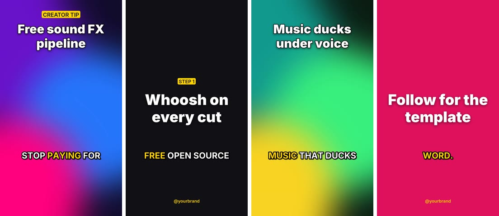
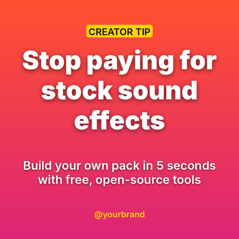
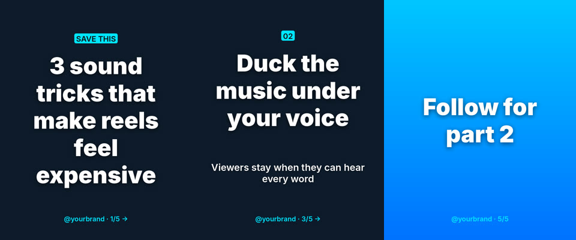

# contentkit

Free, offline, open-source pipeline for social content. Describe a post or video in a
short YAML recipe and get back finished, platform-ready files: posts, carousels, and
reels/shorts with voiceover, word-by-word captions, ducked background music, sound
effects and loudness mastering. No subscriptions, no watermarks, no cloud.



| Post | Carousel |
|---|---|
|  |  |

## Contents

- [Features](#features)
- [How it works](#how-it-works)
- [Setup](#setup)
- [Quick start](#quick-start)
- [Use it in any project](#use-it-in-any-project)
- [Commands](#commands)
- [Recipe reference](#recipe-reference)
- [Sound effects](#sound-effects)
- [Voiceover](#voiceover)
- [Captions](#captions)
- [Project layout](#project-layout)
- [Licenses](#licenses)
- [Free asset sources](#free-asset-sources)
- [Troubleshooting](#troubleshooting)

## Features

- **Posts & carousels**: gradient, solid or photo backgrounds; auto-fitting headline,
  body and kicker label; handle, logo and an automatic `1/N →` slide counter.
- **Videos**: image scenes with Ken Burns zoom, trimmed video clips (with or without
  their own audio), and full-screen text cards; animated title overlays.
- **Sound effects**: 15 effects synthesized locally (you own them), a whoosh on every
  cut, per-scene cues at any timestamp, plus your own sounds with license tracking.
- **Voiceover**: natural offline neural TTS (Piper), espeak-ng fallback, or your own recording.
- **Captions**: "active word" pop captions timed by faster-whisper, or by the script when
  Whisper isn't installed. Also usable on any existing video.
- **Audio mix**: scene audio + voice + music that ducks under the voice + SFX, mastered
  to -14 LUFS so platforms don't turn you down.
- **Formats**: reel/short/story 1080×1920, square 1080×1080, portrait 1080×1350,
  landscape 1920×1080, thumbnail 1280×720.
- **Reference fetching**: yt-dlp downloads with a `.source.json` record of where each
  file came from and its license.

## How it works

```
recipe.yaml ─┬─ post / carousel ── Pillow ─────────────────────────────────► PNG
             │
             └─ video
                 1. voiceover      Piper / espeak-ng / your file
                 2. scenes         each rendered to a uniform clip by ffmpeg
                                   (zoompan, crop-to-fill, title overlay)
                 3. concat         lossless join
                 4. final pass     captions (ASS, libass)
                                   + scene audio + voice + ducked music + SFX
                                   → loudnorm -14 LUFS ──────────────────► MP4
```

Scenes without a `duration` share the voiceover length, so you write the script and the
video sizes itself.

## Setup

Requirements: Linux/macOS (Windows via WSL), Python 3.10+, ffmpeg built with libass
(standard distro builds are).

```bash
sudo apt install ffmpeg espeak-ng            # macOS: brew install ffmpeg espeak-ng
git clone <this repo> contentkit && cd contentkit
python3 -m venv .venv
.venv/bin/pip install -e ".[all]"            # core + Piper TTS + faster-whisper
.venv/bin/python -m piper.download_voices --data-dir ~/.contentkit/voices en_US-ryan-high
.venv/bin/contentkit sfx init                # build the sound-effects pack
```

Install options:

| Install | You get |
|---|---|
| `pip install -e .` | Core: posts, videos, SFX, espeak-ng voice, script-timed captions |
| `pip install -e ".[tts]"` | + Piper neural voices |
| `pip install -e ".[captions]"` | + faster-whisper word-accurate captions |
| `pip install -e ".[all]"` | Everything |

## Quick start

```bash
source .venv/bin/activate
python examples/make_assets.py                          # demo backgrounds + music loop
contentkit post  examples/post.yaml     -o out/post.png
contentkit post  examples/carousel.yaml -o out/carousel
contentkit video examples/reel.yaml     -o out/reel.mp4
```

Then copy an example recipe and edit the text, colors and assets.

## Use it in any project

From the other project's environment:

```bash
pip install -e ~/contentkit                   # local checkout
pip install "git+<repo url>#egg=contentkit[all]"   # or straight from git
```

Keep a `content/` folder in that project with recipes and assets. Asset paths
(`image`, `video`, `file`, `logo`) resolve relative to the recipe file, so the folder is
portable.

Python API:

```python
from contentkit import render_post, render_carousel, render_video, build_sfx_pack, sfx_path

render_post({"format": "square", "title": "Hello", "theme": {"gradient": ["#ff512f", "#dd2476"]}},
            "out/hello.png")

render_video({
    "format": "reel",
    "voiceover": {"text": "Three tips in ten seconds."},
    "music": {"file": "assets/track.mp3", "volume": 0.3},
    "scenes": [
        {"image": "assets/a.jpg", "title": "Tip one", "sfx": ["pop"]},
        {"color": "#111", "title": "Tip two"},
    ],
}, "out/tips.mp4")
```

Note that the Python API does not resolve relative paths against a recipe file; pass
paths relative to your working directory or absolute ones.

## Commands

| Command | What it does |
|---|---|
| `contentkit post RECIPE -o out.png` | Render a post. If the recipe has `slides`, `-o` is a folder and you get `slide_01.png…` |
| `contentkit video RECIPE -o out.mp4 [--keep DIR]` | Render a video. `--keep` saves intermediates (scenes, voice, captions.ass) |
| `contentkit captions VIDEO [--text SCRIPT] [--words 3] [--accent "#ffd400"] [--model small]` | Burn pop captions onto an existing video (transcribed, or timed from `--text`) |
| `contentkit tts "TEXT" -o vo.wav [--engine auto\|piper\|espeak] [--voice V] [--speed 1.1]` | Voiceover only |
| `contentkit sfx init [--force]` | Synthesize the built-in pack into `~/.contentkit/sfx/` |
| `contentkit sfx list` | Library with license and source of every sound |
| `contentkit sfx play NAME` | Preview a sound (needs ffplay) |
| `contentkit sfx add FILE [--name N] --source URL --license LIC` | Add your own sound to the library |
| `contentkit fetch URL [--audio] [--section 12-20] [--license LIC] [--out DIR]` | Download with yt-dlp + write `<file>.source.json` |
| `contentkit formats` | List output sizes |

`python -m contentkit …` works the same as `contentkit …`.

## Recipe reference

### Theme (posts and videos)

```yaml
theme:
  bg: "#101014"                  # solid background
  gradient: ["#ff512f", "#dd2476"]   # top → bottom, overrides bg
  image: assets/bg.jpg           # photo background, cover-cropped, overrides both
  dim: 0.45                      # darken photo backgrounds (0–1)
  text: "#ffffff"
  accent: "#ffd400"              # kicker pill, handle, active caption word
  font: "Inter:black"            # fontconfig name or a .ttf/.otf path
  body_font: "Inter:semibold"
  handle: "@yourbrand"           # footer on posts and cards
  logo: assets/logo.png          # top-right on posts and cards
```

### Post / carousel

```yaml
format: square                   # square | portrait | reel | landscape | thumbnail
theme: {...}
kicker: Creator tip              # small label above the title
title: Main headline             # auto-sized to fit
body: Supporting line
footer: custom footer            # defaults to theme.handle

# carousel: add slides; each slide may override title/body/kicker/footer/theme
slides:
  - {kicker: Save this, title: 3 tricks}
  - {title: Trick one, body: Why it works}
  - {title: Follow for more, theme: {gradient: ["#00c6ff", "#0072ff"]}}
```

### Video

```yaml
format: reel
theme: {...}

voiceover:                       # optional
  text: "Script to speak."       # TTS, or:
  file: assets/voice.wav         # your recording
  engine: auto                   # auto | piper | espeak
  voice: path/to/voice.onnx      # Piper model (default: first in ~/.contentkit/voices)
  speed: 1.0
  delay: 0.3                     # seconds before the voice starts
  volume: 1.0

music:                           # optional; a bare path also works
  file: assets/track.mp3         # loops to the video length, fades in/out
  volume: 0.3
  duck: true                     # compress under the voice

captions:                        # default: on when there is a voiceover; `false` disables
  enabled: true
  source: auto                   # auto | whisper | script
  model: small                   # whisper size: tiny | base | small | medium
  language: en                   # optional, skips language detection
  words: 3                       # words per caption
  position: 0.72                 # vertical centre, fraction of height
  color: "#ffffff"
  accent: "#ffd400"              # active word (defaults to theme.accent)
  font: "Inter:black"
  uppercase: true

transition_sfx: whoosh           # on every cut; null to disable
transition_volume: 0.5
preset: medium                   # x264 preset (faster = quicker render, bigger file)
crf: 20                          # quality, lower = better

scenes:
  - image: assets/a.jpg          # photo scene
    zoom: in                     # in | out | none (default in)
    duration: 3                  # omit to share the voiceover length
    title: Overlay headline
    kicker: Label
    title_position: top          # top | center | bottom
    fade: false                  # fade from/to black
    sfx:                         # cues relative to scene start
      - pop                      # name → at 0s, volume 0.8
      - {name: boom, at: 0.2, volume: 0.7}

  - video: assets/clip.mp4       # video scene, cropped to fill
    start: 3                     # trim start (seconds)
    duration: 4
    keep_audio: true             # mix the clip's own sound
    volume: 0.5

  - color: "#111111"             # text card (no image/video → theme background)
    kicker: Step 1
    title: Card headline
    body: Card body text
```

`sfx` names come from the library (`contentkit sfx list`); a file path works too.

## Sound effects

Built-in pack (synthesized by ffmpeg, peak-normalized to -1 dBFS, stored in
`~/.contentkit/sfx/`):

| Transitions | UI / accents | Impact / tension |
|---|---|---|
| whoosh, swoosh-up, glitch | pop, click, tick, ding, notify, sparkle, shutter | boom, bass-drop, riser, buzzer, heartbeat |

They are generated on your machine, so they carry no third-party license and are safe
for monetized content. Add your own sounds with
`contentkit sfx add laugh.wav --source <url> --license "CC0"`. Anything added without a
license is listed as `UNKNOWN - check before publishing`. The library index is
`~/.contentkit/sfx/library.json`.

## Voiceover

Engine order with `engine: auto`:

1. **Piper**, when `piper-tts` is installed and a `.onnx` voice is found (`voice:` in the
   recipe → `$CONTENTKIT_PIPER_MODEL` → current directory → `~/.contentkit/voices/`).
   Browse voices at huggingface.co/rhasspy/piper-voices and download with
   `python -m piper.download_voices --data-dir ~/.contentkit/voices <voice-name>`.
2. **espeak-ng**: robotic, fine for drafts and timing.

Or skip TTS and record yourself: `voiceover: {file: my_take.wav}`. Captions are then
transcribed from your recording.

## Captions

With faster-whisper installed, the voiceover is transcribed with word timestamps (the
model downloads on first use, ~480 MB for `small`). Without it, words from
`voiceover.text` are spread across the audio by length, which works well for TTS. Each
caption shows `words` words, highlights the active one in the accent color, and pops in.

## Project layout

```
contentkit/
  cli.py        command line + recipe loading (relative path resolution)
  post.py       Pillow renderer: backgrounds, auto-fit text, posts, carousels
  video.py      scene rendering, concat, audio mix, captions, mastering
  sfx.py        synthesized SFX pack + user library with license manifest
  voice.py      Piper / espeak-ng text-to-speech
  captions.py   faster-whisper transcription, script alignment, ASS writer
  fetch.py      yt-dlp downloads with source records
  formats.py    output sizes and loudness target
  fonts.py      fontconfig lookup
  ff.py         ffmpeg/ffprobe helpers
examples/
  post.yaml, carousel.yaml, reel.yaml    annotated recipes
  make_assets.py                         generates assets/ (backgrounds, music loop)
docs/                                    README preview images
```

User data lives outside the repo in `~/.contentkit/` (`sfx/`, `voices/`, `downloads/`).

## Licenses

| Component | License | Note |
|---|---|---|
| ffmpeg | LGPL-2.1+ / GPL (distro builds) | Called as a separate program |
| Pillow | MIT-CMU (HPND) | |
| PyYAML | MIT | |
| faster-whisper + Whisper weights | MIT | |
| piper-tts 1.8 | GPL-3.0 | **Each voice model has its own license.** Check its MODEL_CARD before commercial use |
| espeak-ng | GPL-3.0 | |
| yt-dlp | Unlicense | |
| Inter font | SIL OFL 1.1 | |
| Built-in SFX, demo music and backgrounds | Generated locally | |

What you may publish depends on your **assets**, not the tools. `fetch` downloads are
marked `UNKNOWN` until you give a license. Treat them as reference only until cleared.

## Free asset sources

Check the license of each item:

- **SFX:** Freesound.org (per-sound CC0 / CC-BY, avoid CC-BY-NC for monetized content), Pixabay sound effects
- **Music:** YouTube Audio Library, Pixabay Music, Free Music Archive (per track), incompetech (CC-BY)
- **Images / video:** Pexels, Pixabay, Unsplash, Openverse
- **Trends:** TikTok Creative Center (trending sounds and hashtags), Know Your Meme

Avoid MusicGen/AudioCraft weights for monetized work: they are CC-BY-NC (non-commercial).

Free GUI tools that pair well: Kdenlive or Shotcut (editing), Audacity (audio),
GIMP / Krita / Inkscape (graphics), OBS Studio (recording), Blender (3D and motion).

## Troubleshooting

| Problem | Fix |
|---|---|
| `voiceover: espeak-ng` when you expected Piper | Run through the venv (`.venv/bin/contentkit`) and check a `.onnx` is in `~/.contentkit/voices/` |
| `captions: script timing` | `pip install -e ".[captions]"`; the first run downloads the Whisper model |
| `No font found` | Install the font (`fc-list` to check) or give a `.ttf/.otf` path |
| `warning: voiceover … longer than the scenes` | Remove `duration` from some scenes so they stretch to fit, or lengthen them |
| Slow renders | `preset: veryfast`; image `zoom: none` is fastest; use the whisper `base` model |
| Captions missing / `ass` filter error | Your ffmpeg lacks libass. Install the distro ffmpeg package |
